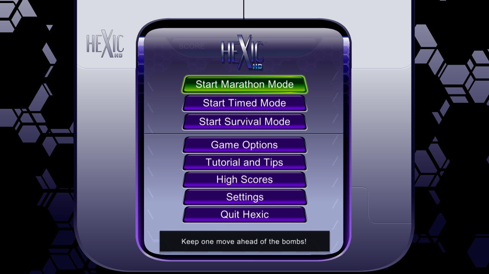
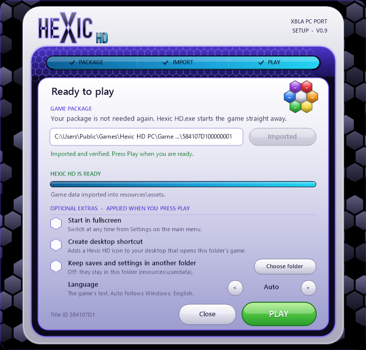
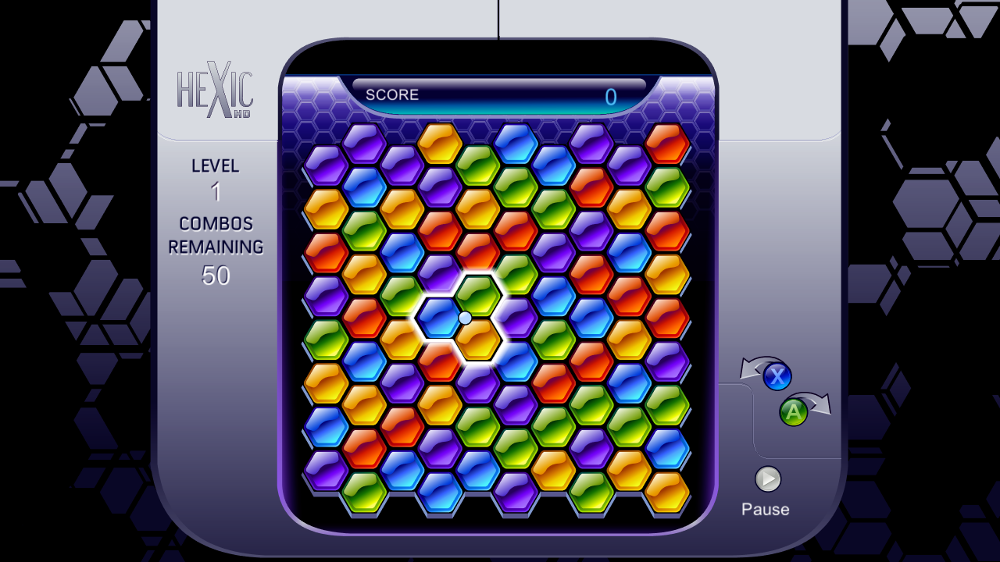
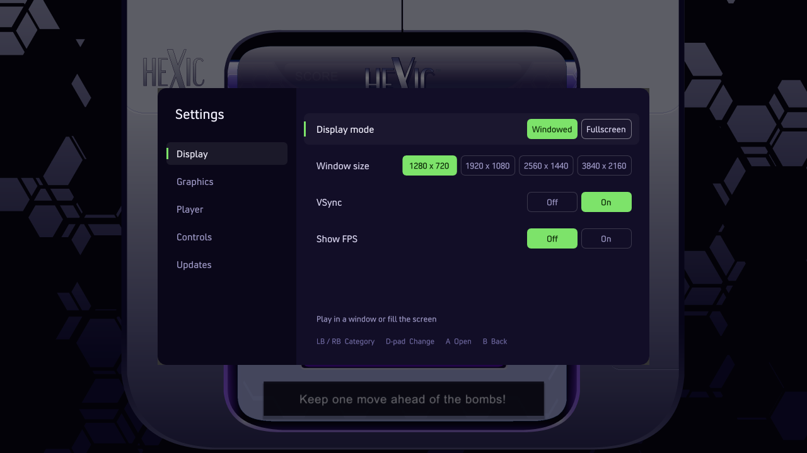
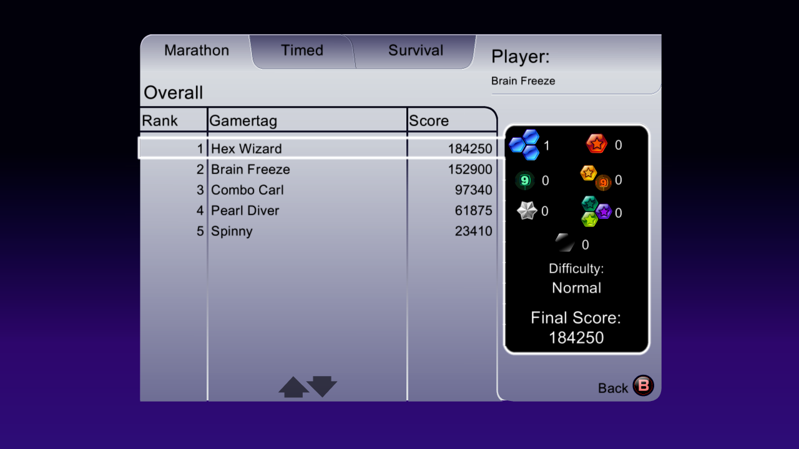

# Hexic HD XBLA PC Recomp

A native Windows PC port of **Hexic HD**, the Xbox 360 launch puzzle game by Carbonated
Games, built using [ReXGlue](https://github.com/rexglue/rexglue-sdk) static recompilation.

Play at **up to 4K and a steady 60 FPS**, with full mouse, keyboard and controller support
that switches on the fly, offline High Scores, nine languages and a native PC settings menu. No
emulator required.

**Free and open-source.**

Like the recomp and want to support future projects? You can tip me on
[Ko-fi](https://ko-fi.com/caiuscodes).

> **You must provide your own copy of Hexic HD XBLA.** No original game files or assets
> are distributed with this project. The launcher imports the required files from your
> Xbox 360 game package during first-time setup.

## Download & Installation

**[Download the latest release](https://github.com/CaiusCodes/Hexic-HD-XBLA-PC-Recomp/releases)**

1. Download the latest ZIP and extract the **Hexic HD PC** folder somewhere writable (not
   Program Files).
2. Run `Hexic HD.exe`.
3. Select your Hexic HD XBLA package using **Browse package**, drag it onto the window, or
   place it alongside the executable (or in a `Game Package` folder) for automatic
   detection.
4. Choose your options: fullscreen, desktop shortcut, an optional folder of your own for
   saves and settings, and the language.
5. Click **Play**.

After setup, simply run `Hexic HD.exe` to play. Your original game package is no longer
needed.

**To reopen setup:** run `Hexic HD.exe --setup`.

The installation is portable, with imported game files, saves and settings stored inside
the game folder.

### System Requirements

- Windows 10 or 11 (64-bit)
- A processor from 2015 onwards (AVX2)
- DirectX 12 or Vulkan-compatible graphics card
- Your own Hexic HD XBLA package (Title ID `584107D1`, version 2.0.1884.0)

## Features

### Graphics & Performance

- **Native PC rendering:** Direct3D 12 or Vulkan, with automatic fallback to the other
- **Up to 4K** with fullscreen and windowed modes
- **Steady 60 FPS** with even frame pacing, V-Sync and an optional FPS counter
- **Render Scale:** 1x, 2x or 3x
- **AMD FSR** upscaling and **FXAA** anti-aliasing
- **Light on the PC:** about a third of one CPU core on the menus

### Controls & Quality of Life

- **Mouse support:** point at a menu item and click it; in a game, the highlighted pieces
  follow the pointer and the mouse buttons rotate them
- Full **keyboard** support with rebindable keys
- **Xbox controller** support
- **Hot-swapping:** button prompts switch between keycaps and controller buttons as soon as
  you change device
- Native PC **Settings** menu in place of the Xbox-only Achievements viewer
- **Nine languages:** English, German, Spanish, French, Italian, Portuguese, Japanese,
  Korean and Traditional Chinese, from the game's own translations (Auto follows your
  Windows language)
- Player name of your choice, shown on High Scores
- Built-in update checker
- Portable installation with local saves and settings, or a saves folder of your choice

### High Scores

The game's Xbox LIVE Leaderboards screen works offline as **High Scores**, keeping your best
Marathon, Timed and Survival scores on this PC.

## Keyboard & Mouse Controls

| Key | Action |
|---|---|
| Mouse | Highlight pieces / menu items |
| Left Click, E, Space, Enter | Rotate clockwise / Select |
| Right Click, Q | Rotate counter-clockwise (in a game) / Back (in menus) |
| Arrow Keys, W A S D | Move |
| Backspace | Back |
| Esc | Pause |

Keys can be customised under **Settings → Controls**.

Xbox controllers use the original console controls.

## Updates

Check for new versions through **Settings → Updates → Check for Updates**.

Updates are downloaded, checked and installed without affecting your imported game files,
saves or settings.

Alternatively, download the latest release ZIP and extract it next to your existing
installation: setup imports straight from the old one, carrying your saves and settings
with it. Older installations using a separate Setup and `Game` folder can also be imported.

## Known Limitations

- Windows only.
- Only the supported Hexic HD XBLA build (Title ID `584107D1`, version 2.0.1884.0) is
  accepted.
- The player name can only be typed on a keyboard.
- Windows SmartScreen may warn about the unsigned executable.

## Reporting Issues

Found a bug? [Open a GitHub Issue](https://github.com/CaiusCodes/Hexic-HD-XBLA-PC-Recomp/issues)
and include your latest log from:

`resources\runtime\logs\`

For setup problems, include `setup.log` from the same folder.

## Building from Source

See [docs/BUILDING.md](docs/BUILDING.md).

## Development & Credits

This project builds upon the work of:

- [ReXGlue](https://github.com/rexglue/rexglue-sdk) by Tom Clay and contributors – Static
  recompilation framework, including code derived from the [Xenia](https://xenia.jp/)
  project.
- [Velocity](https://github.com/hetelek/Velocity) – Xbox 360 package handling, from which
  the launcher's package reader is derived.
- SDL, Dear ImGui, FFmpeg and the other open-source components listed in
  [packaging/licenses](packaging/licenses).

The project's own code is released under the [MIT License](LICENSE). The launcher includes
GPL-3.0 components derived from [Velocity](https://github.com/hetelek/Velocity), and
third-party dependencies retain their respective licences. The MIT License does not cover
`generated/`, which is machine-translated from the game program, or the game itself.

---

*Hexic HD and Xbox are trademarks or property of their respective owners. This is an
independent fan project and is not affiliated with or endorsed by Microsoft or Carbonated
Games.*
